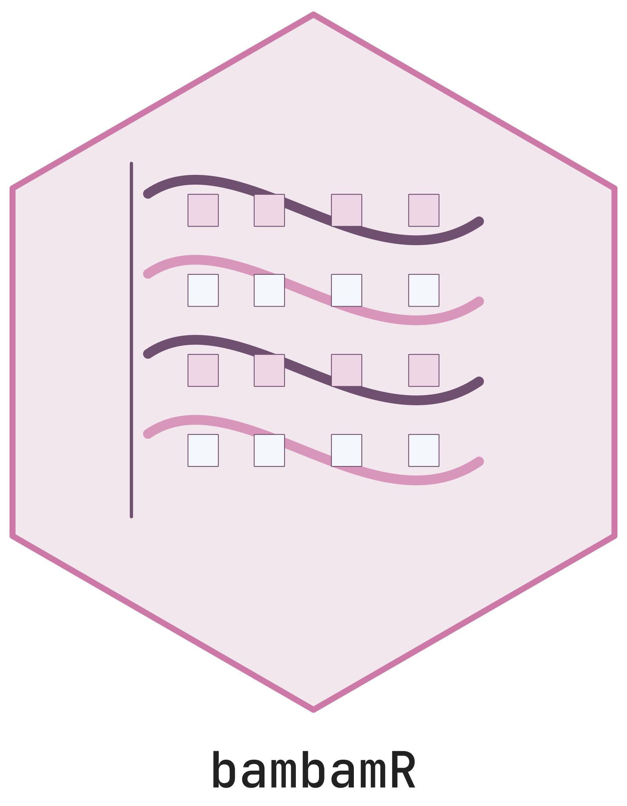

# bambamR 

Version 0.2.0, prepared for CRAN submission. A published release DOI has
not been verified; see [release
status](https://cttir.github.io/bambamR/MAINTENANCE.md).

**End-to-end RNA-seq processing from FASTQ to publication-ready plots.**

bambamR provides a streamlined toolkit for RNA-seq analysis covering
FASTQ/BAM import, quality control, alignment, read counting,
normalization, differential expression analysis, and publication-ready
visualizations including onco plots, volcano plots, heatmaps, and PCA.

## Two Operating Modes

CPM/TPM normalization and basic plots work with CRAN dependencies.
Differential expression needs the selected Bioconductor engine. Missing
engines produce an error; use `skip = "de"` for a normalization-only
pipeline.

| Feature | Minimal (CRAN-only) | Full (+ Bioconductor) |
|----|:--:|:--:|
| CPM / TPM normalization | Yes | Yes |
| TMM / RLE normalization | – | Yes (edgeR / DESeq2) |
| Differential expression | – | Yes (DESeq2, edgeR, limma-voom) |
| PCA, volcano, heatmap, MA | Yes | Yes |
| **Onco plots** | **Yes** | **Yes** |
| FASTQ / BAM import | Base-R FASTQ / external samtools for BAM | ShortRead / Rsamtools |
| Alignment wrappers | STAR / HISAT2 / minimap2 | STAR / HISAT2 / minimap2 |
| Read counting | featureCounts CLI | GenomicAlignments |
| Shiny interactive app | Yes | Yes |

## Installation

``` r

# Install from CRAN (when available)
install.packages("bambamR")

# Or install the development version from GitHub
# install.packages("pak")
pak::pak("cttir/bambamR")
```

Optionally install Bioconductor packages for full-mode features:

``` r

if (!requireNamespace("BiocManager", quietly = TRUE))
  install.packages("BiocManager")

BiocManager::install(c(
  "DESeq2", "edgeR", "limma",
  "ShortRead", "Rsamtools",
  "GenomicAlignments", "GenomicRanges", "GenomicFeatures", "txdbmaker",
  "SummarizedExperiment"
))
```

## First use from this checkout

Prerequisites: R \>= 4.1 and an internet connection to install CRAN
dependencies. From the repository directory:

``` sh
Rscript --vanilla -e 'install.packages(c("ggplot2", "data.table"), repos="https://cloud.r-project.org")'
R CMD INSTALL .
Rscript --vanilla -e 'library(bambamR); ex <- bb_example_counts(); result <- bb_pipeline(count_matrix=ex$counts, sample_info=ex$metadata, output_dir=tempfile("bambamR-"), skip="de"); stopifnot(result$status == "complete"); print(result)'
```

For the app, install `shiny` and optionally `bslib` and `DT`, then run
`bambamR::bb_run_app(host = "127.0.0.1")`. Load the example data, select
**Normalization only**, and run the analysis. External aligners,
samtools, featureCounts and optional statistical engines are separate
prerequisites. See [the maintenance
record](https://cttir.github.io/bambamR/MAINTENANCE.md) for tested
versions and release gates.

## Bundled Example Datasets

bambamR ships with ready-to-use example data so you can explore
normalization and plotting without downloading external files. New DE
analyses still require Bioconductor; annotation tracks require
`patchwork`:

| Function | Contents |
|----|----|
| [`bb_example_counts()`](https://cttir.github.io/bambamR/reference/bb_example_counts.md) | RNA-seq count matrix (200 genes x 10 samples) with sample metadata (condition, batch, sex, age). First 20 genes have simulated DE between control and treatment. |
| [`bb_example_mutations()`](https://cttir.github.io/bambamR/reference/bb_example_mutations.md) | Mutation calls (300 mutations, 50 samples, 20 cancer genes) plus clinical annotations (Stage, Gender, Smoking) for oncoplot demos. |
| [`bb_example_de()`](https://cttir.github.io/bambamR/reference/bb_example_de.md) | Pre-computed DE results (500 genes) with log2FC, p-values, and base means – works without Bioconductor. |

A small FASTQ file (`example_reads.fastq`, 100 reads) and gene-length
table are also included under `inst/extdata/`.

## Quick Start

``` r

library(bambamR)

# ── 1. Load example data ───────────────────────────────────
ex <- bb_example_counts()
str(ex)
# List of 2
#  $ counts  : int [1:200, 1:10] ...
#  $ metadata: data.frame (10 obs. of 4 variables)

# ── 2. Normalize ───────────────────────────────────────────
cpm <- bb_normalize(ex$counts, method = "cpm")

# ── 3. PCA ─────────────────────────────────────────────────
bb_pca(cpm, ex$metadata, color_by = "condition")

# ── 4. Heatmap of top variable genes ──────────────────────
bb_heatmap(cpm, n_genes = 30)

# ── 5. Differential expression (requires DESeq2) ──────────
if (requireNamespace("DESeq2", quietly = TRUE)) {
  de <- bb_deseq2(ex$counts, ex$metadata)
  bb_volcano(de)
  bb_ma_plot(de)
}

# ... or use the pre-computed DE results (no Bioconductor!) ─
de <- bb_example_de()
bb_volcano(de, n_label = 10)
bb_ma_plot(de)

# ── 6. Heatmap of top DE genes ────────────────────────────
bb_heatmap(cpm, de_result = de, n_genes = 30)

# ── 7. Oncoplot ───────────────────────────────────────────
mut <- bb_example_mutations()
bb_oncoplot(mut$mutations, n_genes = 15)
# With annotation tracks: install.packages("patchwork")
# bb_oncoplot(mut$mutations, n_genes = 15, annotation_df = mut$clinical)

# ── 8. Read a FASTQ file ─────────────────────────────────
fq <- system.file("extdata", "example_reads.fastq", package = "bambamR")
reads <- bb_read_fastq(fq, n = 5)
reads

# ── 9. Export ─────────────────────────────────────────────
bb_export_csv(de, "de_results.csv")
```

## Full Pipeline (FASTQ to Results)

When you have FASTQ files, a genome index, and a GTF annotation, run the
single-end pipeline in one call. Each FASTQ file is one sample; metadata
rownames must equal filenames without `.fastq`, `.fq` or their `.gz`
suffix. The pipeline does not infer paired-end mates. For pairs, call
[`bb_align()`](https://cttir.github.io/bambamR/reference/bb_align.md)
with two explicit paths and `paired = TRUE`, then
`bb_count_reads(paired = TRUE)`. Use a new output directory for each
run:

``` r

result <- bb_pipeline(
  fastq_dir    = "raw_reads/",
  genome_index = "STAR_index/",
  annotation   = "genes.gtf",
  sample_info  = sample_metadata,
  aligner      = "STAR",
  de_method    = "DESeq2",
  threads      = 8
)

# The result object bundles everything
result$counts       # count matrix
result$de_results   # DE data.frame
result$plots$pca    # ggplot object
result$plots$volcano
```

You can also enter the pipeline at any stage:

``` r

# From BAM files (skip alignment)
result <- bb_pipeline(bam_dir = "aligned/", annotation = "genes.gtf",
                      sample_info = meta)

# From a count matrix (skip alignment + counting)
result <- bb_pipeline(count_matrix = my_counts, sample_info = meta)
```

## Interactive Shiny App

``` r

bb_run_app()
```

Upload your count matrix and metadata through the browser, configure
normalization and DE parameters, run the analysis, and explore plots.
Choose **Normalization only** for CRAN-only use. TPM is available
through the R API with gene lengths; the app offers CPM, TMM and RLE.
CSV/TSV counts need a first column of unique gene IDs and numeric sample
columns; metadata need a first column of sample IDs matching all
samples. Uploads and analysis-setting changes clear derived results. A
failed run cannot export results from an earlier run. Export successful
results as CSV, RDS or PDF. The app is intended for local use
(`host = "127.0.0.1"`).

## Function Reference

All exported functions use the `bb_` prefix and return standard R
objects (data.frames, matrices, ggplot objects).

### Import

- [`bb_read_fastq()`](https://cttir.github.io/bambamR/reference/bb_read_fastq.md)
  – read FASTQ files (ShortRead or base-R fallback)
- [`bb_read_bam()`](https://cttir.github.io/bambamR/reference/bb_read_bam.md)
  – read BAM files (Rsamtools or system samtools)
- [`bb_count_bam()`](https://cttir.github.io/bambamR/reference/bb_count_bam.md)
  – count reads in a BAM file

### Quality Control

- [`bb_qc()`](https://cttir.github.io/bambamR/reference/bb_qc.md) –
  compute QC metrics from FASTQ / BAM
- [`bb_qc_summary()`](https://cttir.github.io/bambamR/reference/bb_qc_summary.md)
  – tabular QC summary
- [`bb_plot_qc()`](https://cttir.github.io/bambamR/reference/bb_plot_qc.md)
  – per-position quality, GC, read-length plots

### Alignment & Counting

- [`bb_align()`](https://cttir.github.io/bambamR/reference/bb_align.md)
  – align reads with STAR, HISAT2, or minimap2
- [`bb_count_reads()`](https://cttir.github.io/bambamR/reference/bb_count_reads.md)
  – count reads per gene (GenomicAlignments or featureCounts)

### Normalization

- [`bb_normalize()`](https://cttir.github.io/bambamR/reference/bb_normalize.md)
  – CPM, TPM, TMM, or RLE normalization

### Differential Expression

- [`bb_deseq2()`](https://cttir.github.io/bambamR/reference/bb_deseq2.md)
  – DESeq2 wrapper (requires DESeq2)
- [`bb_edger()`](https://cttir.github.io/bambamR/reference/bb_edger.md)
  – edgeR quasi-likelihood wrapper (requires edgeR)
- [`bb_limma_voom()`](https://cttir.github.io/bambamR/reference/bb_limma_voom.md)
  – limma-voom wrapper (requires limma + edgeR)

### Visualization (all return ggplot objects)

- [`bb_oncoplot()`](https://cttir.github.io/bambamR/reference/bb_oncoplot.md)
  – publication-ready waterfall mutation plot
- [`bb_volcano()`](https://cttir.github.io/bambamR/reference/bb_volcano.md)
  – volcano plot with auto-labeling
- [`bb_heatmap()`](https://cttir.github.io/bambamR/reference/bb_heatmap.md)
  – clustered heatmap of top genes
- [`bb_pca()`](https://cttir.github.io/bambamR/reference/bb_pca.md) –
  PCA with metadata coloring
- [`bb_ma_plot()`](https://cttir.github.io/bambamR/reference/bb_ma_plot.md)
  – MA plot (mean expression vs. fold change)

### Pipeline & Export

- [`bb_pipeline()`](https://cttir.github.io/bambamR/reference/bb_pipeline.md)
  – run the full pipeline end-to-end
- [`bb_export_csv()`](https://cttir.github.io/bambamR/reference/bb_export_csv.md)
  /
  [`bb_export_tsv()`](https://cttir.github.io/bambamR/reference/bb_export_tsv.md)
  /
  [`bb_export_rds()`](https://cttir.github.io/bambamR/reference/bb_export_rds.md)
  – export results

### Example Data

- [`bb_example_counts()`](https://cttir.github.io/bambamR/reference/bb_example_counts.md)
  – example count matrix + metadata
- [`bb_example_mutations()`](https://cttir.github.io/bambamR/reference/bb_example_mutations.md)
  – example mutation data + clinical annotations
- [`bb_example_de()`](https://cttir.github.io/bambamR/reference/bb_example_de.md)
  – pre-computed DE results

### Shiny App

- [`bb_run_app()`](https://cttir.github.io/bambamR/reference/bb_run_app.md)
  – launch the interactive Shiny application

## Authors

- **Raban Heller** (maintainer) - SingleCellLab
- **Hanno Witte** - SingleCellLab
- **Konrad Steinestel** - SingleCellLab

## Citation

If you use bambamR in your research, please cite:

    Heller R, Witte H, Steinestel K (2026). bambamR: RNA-Seq Processing from
    FASTQ Files to Publication-Ready Plots. R package version 0.2.0.
    https://github.com/CTTIR/bambamR

## License

MIT

## Use of LLM tools

Where applicable, LLM tools were used for narrowly defined,
non-authorial tasks: copyediting, prose refinement, Markdown/LaTeX
formatting, boilerplate scaffolding (such as CI configurations and build
scripts), and code refactoring. Tools included [Chat
AI](https://kisski.gwdg.de/leistungen/2-02-llm-service/), the KISSKI
(GWDG) service, and self-hosted **Mistral Small (24B, Apache-2.0)**
served through a local **vLLM architecture** on an Ubuntu Linux
workstation with Intel processors and NVIDIA GPUs. Self-hosted use also
includes models that were further trained (fine-tuned) or weight-edited
in-house for specific tasks. All self-hosted models ran locally, with no
data sent to third parties.

All scientific claims, methodological choices, analyses, interpretations
and conclusions remain the authors’ own. Where applicable, LLM-generated
material must be reviewed and revised before inclusion, and references
must be verified against their DOI, arXiv ID or ISBN.

Local software setup: vLLM with Python/PyTorch, plus R and RStudio.

## Branding

Editable R artwork and regeneration instructions are in
[tools/branding](https://github.com/CTTIR/bambamR/blob/main/tools/branding/README.md).

## Input and analysis guarantees

Counts must be finite and non-negative with unique gene/sample
identifiers. Normalization rejects empty libraries. Named TPM lengths
are matched by gene ID; all lengths must be finite and positive.
Metadata must match every sample exactly and are reordered to the count
columns. Deliberately subset both inputs before analysis if only a
subset is intended.

The edgeR pipeline uses the supplied design; its last coefficient is
tested. limma accepts one contrast per call. A requested DE failure
stops the pipeline; plot failures emit warnings and are recorded in
`result$warnings` and `result$status`. Existing alignment directories
and pipeline result files are protected from reuse.

Oncoplot percentages use all samples represented in the input mutation
table, even after selecting genes. Samples with no recorded mutations
cannot be inferred from that table. These percentages are not a
population prevalence estimate. Internal read counting supports
exon/gene_id annotations; choose featureCounts for other features or
grouping attributes. The two counting backends have distinct
overlap/paired-read policies and should not be exchanged in an ongoing
study without validating the resulting counts. Neither backend currently
exposes strand-specific counting through this API.
